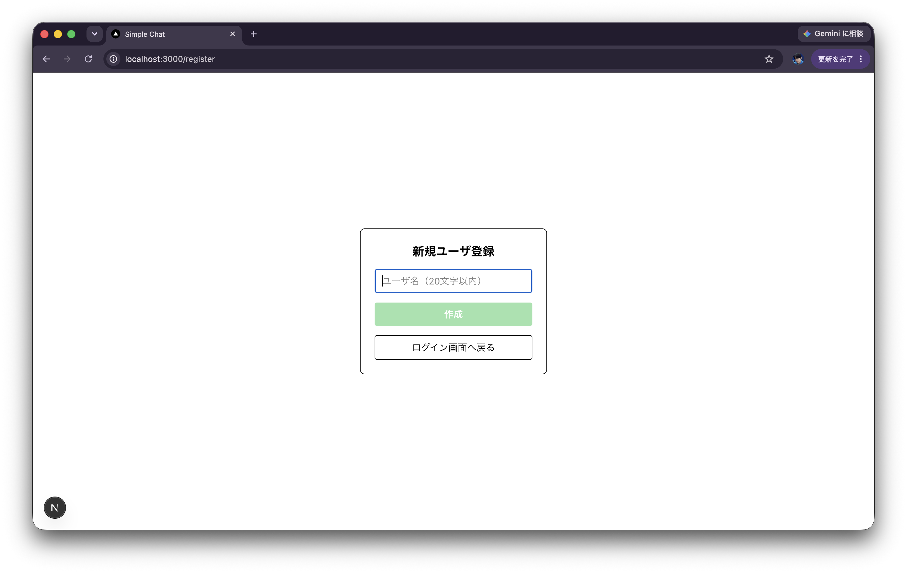
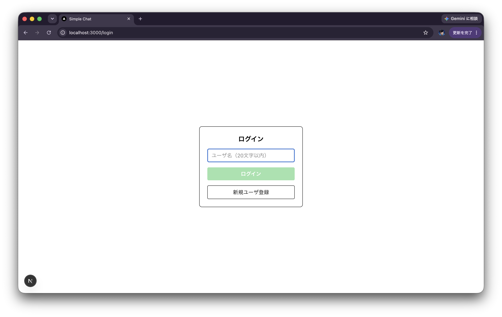
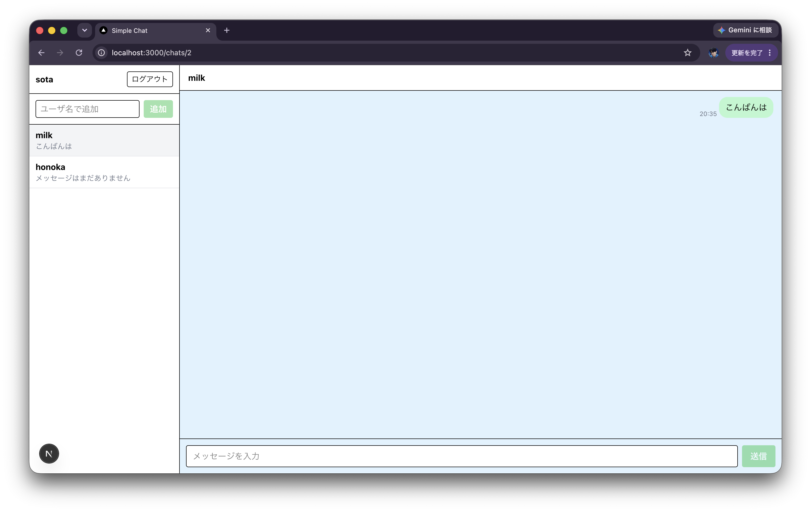

# 簡易チャットアプリ

## 概要
LINE 風の簡単なチャットアプリ
- フロントエンド：Next.js
- バックエンド：FastAPI
- データベース：SQLite

## 起動方法
```bash
# バックエンド（http://localhost:8000）
cd backend
uv sync
uv run fastapi dev app/main.py
```

```bash
# フロントエンド（http://localhost:3000）
cd frontend
npm install
npm run dev
```
```bash
# API を確認する際にはバックエンドを起動した状態でブラウザーの URL を展開
http://127.0.0.1:8000/docs
```

## 要件定義
### ログイン画面
#### ユーザー名登録


- 新たにユーザーを作成してDBに保存
- 既存のユーザー名は利用不可
- 名前の制限
    - 20文字以内
    - 大文字小文字区別

#### ユーザー名認証


- 入力されたユーザー名が存在するかをDBに確認
- 確認できればログイン（cookie．ランダムなセッションIDを入れる）
- チャットルーム画面へ

### チャットルーム画面


#### 会話ルーム（1対1の対話相手）作成
- 入力欄に相手ユーザー名を入力
- 名前存在
    - ルーム未作成 → 新規作成
    - ルーム既存 → そのルームを選択

#### ルーム一覧の表示
- すでに参加しているルームの一覧を左サイドバーに表示
- 最終メッセージ日時の新しい順でソート
    - メッセージのないルームは作成日時を代わりに使用
    - 日時が同じ場合はルーム id の降順
- 相手の名前と最終メッセージの表示
- 選択するとメッセージ一覧へ
- 3 秒ごとのポーリングで一覧を更新

#### ルーム内のメッセージ一覧の表示
- 過去のメッセージのやり取りを表示（送信日時順）
- タイムスタンプあり
- 相手は左寄せ，自分は右寄せでメッセージを表示
- 2 秒ごとのポーリングで新着メッセージを取得
- 初回は最新から 50 件取得し表示
- 上へスクロールして先頭付近に達したら，さらに過去の 50 件を取得して表示

#### メッセージ送信フォーム
- 入力欄に入力して送信すると，メッセージをDBに保存 + 一覧に表示
- テキストのみ
    - 1000 文字以内

### 非実装内容
- ユーザの同姓同名回避（今後はメールアドレスで一意にする予定）
- ログイン時のパスワード
- マルチモーダルな情報の送信
    - 実装する場合の検討事項：保存期間の制限，データの圧縮
- cookieの有効期限
- 対話ルームの相手許可
- グループチャット
- メッセージ編集・削除
- 長い履歴の表示の最適化
    - 現状はフロントが取得済みのメッセージを全件保持・描画するため，大規模化していくと重くなる
- メッセージ検索機能

## DB 設計
### users（ユーザー管理）
| カラム | 制約 |
| --- | --- |
| id | PRIMARY KEY |
| name | UNIQUE |
| created_at | |

### sessions（cookieのセッション管理）
| カラム | 制約 |
| --- | --- |
| token | PRIMARY KEY |
| user_id | FOREIGN KEY → users |
| created_at | |

### rooms（対話ルーム管理）
| カラム | 制約 | 説明 |
| --- | --- | --- |
| id | PRIMARY KEY | |
| direct_user_low_id | FOREIGN KEY → users，NULL 可 | 参加者2人のうち小さい方の id |
| direct_user_high_id | FOREIGN KEY → users，NULL 可 | 参加者2人のうち大きい方の id |
| created_at | | |
| last_message_id | FOREIGN KEY → messages，NULL 可 | 最新メッセージ id．なければ NULL |

- `direct_user_low_id`と`direct_user_high_id`の組が UNIQUE
- `CHECK(direct_user_low_id < direct_user_high_id)`で大小確認
- `last_message_id`を非正規化して保持 → ルーム一覧画面での最新メッセージ表示を高速化
- ルーム一覧は `COALESCE(最新メッセージの created_at, rooms.created_at)` の降順で並べる（並べ替え用の列は持たない）

### room_members（対話ルーム内のメンバー管理）
| カラム | 制約 | 説明 |
| --- | --- | --- |
| room_id | FOREIGN KEY → rooms | user_id との組が PRIMARY KEY |
| user_id | FOREIGN KEY → users | room_id との組が PRIMARY KEY |

- ルーム内でのユーザーごとの情報を管理する目的

### messages（送信されたメッセージの管理）
| カラム | 制約 | 説明 |
| --- | --- | --- |
| id | PRIMARY KEY | |
| room_id | FOREIGN KEY → rooms | |
| sender_id | FOREIGN KEY → users | APIリクエストからではなくセッションから取得 |
| body | | |
| created_at | | |
